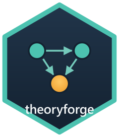

# theoryforge (Python) 

<!-- badges: start -->
[](https://github.com/pablobernabeu/theoryforge/actions/workflows/ci.yml)
[](https://pablobernabeu.github.io/theoryforge/python/)
[](https://pypi.org/project/theoryforge/)
[](https://pypi.org/project/theoryforge/)
[](https://opensource.org/license/MIT)
[](https://doi.org/10.5281/zenodo.21229964)
<!-- badges: end -->

Psychological theories are mostly stated in words, and a verbal theory often leaves unclear
what it asserts. Its constructs are loosely defined, its predictions seldom say which result
would count against them, and a failed test can be absorbed by an assumption added after the
fact (Meehl, 1990; Scheel et al., 2021). theoryforge holds a theory as a YAML or JSON file
with a fixed schema: its constructs and their measures, the propositions that relate them,
the predictions derived from those propositions, its auxiliary assumptions, its rival
accounts and its record of tests. From that file, the package computes what can be checked
mechanically.

It scores the theory against a 12-item rigour checklist and reads the propositions as a
causal graph, from which it derives the conditional independencies the graph implies and
whether the graph entails each claim the theory states. It compares the theory with a rival
account or with an earlier version of itself, grades how risky each prediction's claim is
before data and how severely a recorded test probed it, and writes the theory and hypotheses
sections of a preregistration and a dossier for reviewers. A literature layer maps a
bibliographic corpus into keyword themes and shows which of them share words with the theory
and its rivals.

These are checks of what the file states, and none of them shows that a theory is true. The
checklist's weights are a convention, so the report gives the range of the score under other
weightings. The causal reading assumes that the propositions state every direct relation
among the constructs, with an association for each common cause they leave unnamed. A word
that a theory shares with a literature theme does not show that the theory accounts for what
the theme's records report.

## Installation

The package is on [PyPI](https://pypi.org/project/theoryforge/):

```bash
pip install theoryforge
```

The optional render extra adds the graphviz library, through which `render_diagram()` shows
a diagram in a notebook or writes it to an image file, the latter with the Graphviz programs
installed:

```bash
pip install "theoryforge[render]"
```

The development version installs from the `python/` subdirectory of the repository:

```bash
pip install "git+https://github.com/pablobernabeu/theoryforge.git#subdirectory=python"
```

## Quick start

The package includes four example theories and two literature corpora, and `example_path()`
gives the path of each, so the code below runs straight after `pip install`. It builds a
small theory, checks it and asks what its causal graph says, then takes a bundled theory of
panic disorder through the rest of the workflow.

```python
import theoryforge as tf

# Build a small theory. Each builder records its step in the provenance.
theory = (
    tf.new_theory("panic_demo", "A demonstration theory of panic")
    .add_construct("arousal", "Physiological arousal", "bodily signs of sympathetic activation",
                   measurement=["heart_rate"], boundary_conditions=["adults"])
    .add_construct("threat", "Perceived threat", "appraisal of bodily sensations as dangerous",
                   measurement=["bsiq"], boundary_conditions=["adults"])
    .add_proposition("p1", "arousal", "threat", "increases",
                     mechanism="rising arousal is read as evidence of danger")
    .add_prediction("pred1", "Higher arousal raises perceived threat.", "directional",
                    derives_from=["p1"],
                    claim={"kind": "effect", "x": "arousal", "y": "threat", "sign": "positive"})
)
theory.validate(full=True)  # raises with every problem it finds

# Check it against the rigour checklist and list the items that do not pass.
report = theory.check()
print(report["aggregate_score"], report["aggregate_range"], report["gate"])
not_passed = [(item["id"], item["status"]) for item in report["items"]
              if item["status"] in ("warn", "fail")]
print(not_passed)

# Ask what the causal graph of the propositions says of the claim.
print(theory.entailments()["claims"][0]["verdict"])

# The bundled panic network has a feedback loop, so its implied independencies are
# read by sigma-separation. Its amended version is appraised against it.
v1 = tf.read(tf.example_path("panic-network.theory.yaml"))
v2 = tf.read(tf.example_path("panic-network-2026-v2.theory.yaml"))
print(v1.implications(cycles="sigma")["implications"])
print(v2.appraise_amendment(v1)["verdict"])

# Prepare a test: the riskiness of each claim's form, then the theory and hypotheses
# sections of a preregistration, in Markdown.
print(v1.severity())
print(v1.preregister(cycles="sigma"))

# Set the theory's words against the themes of the demonstration corpus.
corpus = tf.read_corpus(tf.example_path("panic-corpus.yaml"))
print([(theme["id"], theme["status"]) for theme in v1.landscape(corpus)["themes"]])
```

The items that warn or fail name what the theory has not yet stated. Precision asks for
point or interval claims whose bounds state the region they allow, risk_severity for claims
whose form forbids more outcomes, diagnosticity for a rival that a prediction tells apart
from the theory and formalisation for a formal model. The gate blocks only when a blocker
item (falsifiability or derivation_chain) fails, and never for a theory at draft maturity. A
theory of your own is read with `tf.read()` from the path of its YAML or JSON file. The [Get
started](https://pablobernabeu.github.io/theoryforge/python/getting-started/) page on the
documentation site introduces the workflow at more length.

## Functions by stage of the workflow

Every function that takes a theory is also a method of `Theory`, so `tf.check(theory)` and
`theory.check()` give the same result.

### Build

`new_theory()` starts a theory, and the `add_*` methods add constructs, propositions,
predictions, phenomena, auxiliary assumptions, alternatives, evidence and test outcomes,
each recording its step in the theory's provenance. `set_formal_model()` records a formal
model. The builders change the theory in place, so an amended version starts from `copy()`.
`read()` and `write()` read and write YAML or JSON, and `read_dagitty()` makes a theory of a
causal diagram drawn in DAGitty, whose constructs then need definitions. `content_hash()`
gives the SHA-256 digest of the theory's content, which the preregistration and the dossier
carry so that a reader can confirm which file they describe. `example_names()` and
`example_path()` list and locate the bundled examples.

### Check

`validate()` checks the fields the schema requires and their allowed values, and with
`full=True` also every type, reference, claim and unknown field. `check()` scores the theory
against the rigour checklist. Each of its 12 items has a status, a score and a weight, and
the report adds a weighted aggregate, its range under other weightings and a gate that
blocks when a blocker item fails. `report()` gives the same as JSON or as an HTML fragment.
`redundancy_check()` flags a pair of constructs when their definitions are near duplicates,
when one definition is contained in the other, when the two carry the same label or when
every measure of one is listed for the other. `embedding_redundancy()` compares definitions
with an embedding model that you supply. The checklist reads what the file states. It cannot
judge whether a definition is apt or a mechanism plausible, and a lexical screen misses a
definition reworded into other words.

### Derive and compare

`implications()` reads the propositions as a causal graph, with directed relations as arrows
and associations as unexplained covariance, and lists the conditional independencies the
graph implies. It refuses a graph with a feedback loop unless `cycles="sigma"`, which reads
the graph by sigma-separation. Those statements hold if each loop settles to a unique
equilibrium. The statements concern constructs. A conditional independence tested on
fallible measures is rejected too often, so a latent-variable model is the better test.
`entailments()` reads each claim of a prediction or phenomenon against the graph and says
whether the graph entails it, contradicts it or leaves it open. For an effect in a graph
without a feedback loop, it also says whether adjusting for some of the constructs
identifies the effect in observational data and names a minimal such set.
`equivalent_models()` lists the causal directions that no observational study can test.
`discriminate()` sets the theory against a rival, either an alternative that states its own
propositions or another theory, and lists the claims, independencies and signs that would
tell the two apart. `appraise_amendment()` compares two versions of a theory and calls the
amendment progressive, degenerating or neutral in the sense of Lakatos (1970). `simulate()`
runs the construct network as a linear dynamical system with one coupling gain. Its
trajectory shows what the propositions imply under that model and is not fitted to data.

### Test

`severity()` grades each prediction by the form of its claim before data, from an existence
claim, which forbids least, to a point claim. `compile_sem()` writes lavaan model syntax,
with a labelled path for each directed relation, the sign each states as a comment, a
definition of each effect that a claim concerns and a note on identification.
`preregister()` writes the theory and hypotheses sections of a preregistration in Markdown,
with the sampling plan the file records, the implied independencies and, for each
hypothesis, its claim, adjustment set and rivals. The study design, the analysis plan and
the inference criteria are left to the author. Once a test outcome records an estimate and
its standard error, `post_data_severity()` computes how severely a bounded prediction passed
(Mayo & Spanos, 2006). It uses a normal approximation, which overstates the severity of an
estimate inside the region when the standard error comes from a small sample.

### Document

`diagram()` writes ten views of a theory as Graphviz DOT, DAGitty code or SVG: the
nomological network, the causal graph, the provenance, a roadmap of the checklist items
still to meet, the pipeline from predictions to test results, the theory's constructs, scope
and rivals, the workflow from constructs to tests, the overlap of construct scopes, the
rigour checklist and the riskiness of each prediction. `render_diagram()` draws a view with
the render extra. `dossier()` gathers the checklist, the severities, the test record, the
causal reading, the rivals, the provenance and the preregistration in one Markdown document
for reviewers. `render_report()` wraps the dossier in a Quarto document, and `osf_push()`
deposits it in an OSF project, as a dry run unless asked otherwise.

### Literature

`read_corpus()` reads a corpus of bibliographic records. `litmap()` maps keyword
co-occurrence, themes and co-citation. Its default method takes connected components, which
join most keywords of a real corpus into one theme, so it warns when that happens. The
`simple_centres` method forms bounded themes and places each on the strategic diagram by its
centrality and density (Coulter et al., 1998). `landscape()` marks each theme
under-theorised, covered or crowded by how many of the theory and its registered rivals
share a word with it, and names the words. `lit_diagram()` draws the co-occurrence,
co-citation and landscape maps. `new_evidence_dois()` lists the DOIs among a set of
candidates that the theory does not yet cite. `fetch_corpus()`, the only function of the
literature layer that needs a network connection, assembles a corpus from OpenAlex. The
match of words is lexical. It shows that a theme and an account use a word in common, and it
misses an account that names the same idea in other words.

### Apps

The [Python app](https://pablobernabeu.github.io/theoryforge/apps/py/) runs this package in
the browser through [Pyodide](https://pyodide.org/), with nothing to install, and the [R
app](https://pablobernabeu.github.io/theoryforge/apps/r/) runs the R package through webR.
Each has a theory editor, with forms beside the YAML source, and runs the package's
operations on the theory, from the checklist to the literature map. Every result comes with
the Python or R code that reproduces it, and every figure can be saved as SVG or PNG.

## Two languages, one specification

The [R package](https://pablobernabeu.github.io/theoryforge/r/) of the same name offers the
same functions. Each R name adds the prefix `tf_`, so `check()` is `tf_check()`, except that
`new_theory()` is `tf_theory()`. The proposition builder's `frm` is `from` in R, a word that
Python reserves. R has no methods on a theory, and its builders return a modified copy, so
it has no `copy()`. Both packages follow one specification,
[`API_SPEC.md`](https://github.com/pablobernabeu/theoryforge/blob/main/API_SPEC.md), which
sets out each algorithm and output format. Continuous integration compares the outputs of
the two packages on every example and on a set of malformed and awkward theories, so the
same file gives the same verdicts, the same numbers and byte-identical diagrams and
documents in both. The functions that depend on something outside the package can differ:
`fetch_corpus()` on OpenAlex, `osf_push()` on OSF, `embedding_redundancy()` on the embedding
model and `render_diagram()` on the renderer.

## Citation

Please cite theoryforge if it contributes to work you publish. The [About
page](https://pablobernabeu.github.io/theoryforge/python/about/) gives the citation with a
BibTeX entry. The citation gives the concept DOI of the Zenodo archive,
<https://doi.org/10.5281/zenodo.21229964>, since PyPI assigns no DOI. The archive holds
every GitHub release of both packages. The repository also includes `CITATION.cff`, which
GitHub uses for its 'Cite this repository' button.

## References

Coulter, N., Monarch, I., & Konda, S. (1998). Software engineering as seen through its
research literature: A study in co-word analysis. *Journal of the American Society for
Information Science*, *49*(13), 1206–1223.
[https://doi.org/10.1002/(SICI)1097-4571(1998)49:13<1206::AID-ASI7>3.0.CO;2-F](https://doi.org/10.1002/(SICI)1097-4571(1998)49:13%3C1206::AID-ASI7%3E3.0.CO;2-F)

Lakatos, I. (1970). Falsification and the methodology of scientific research programmes. In
I. Lakatos & A. Musgrave (Eds.), *Criticism and the growth of knowledge* (pp. 91–196).
Cambridge University Press. <https://doi.org/10.1017/CBO9781139171434.009>

Mayo, D. G., & Spanos, A. (2006). Severe testing as a basic concept in a Neyman–Pearson
philosophy of induction. *The British Journal for the Philosophy of Science*, *57*(2),
323–357. <https://doi.org/10.1093/bjps/axl003>

Meehl, P. E. (1990). Appraising and amending theories: The strategy of Lakatosian defense
and two principles that warrant it. *Psychological Inquiry*, *1*(2), 108–141.
<https://doi.org/10.1207/s15327965pli0102_1>

Scheel, A. M., Tiokhin, L., Isager, P. M., & Lakens, D. (2021). Why hypothesis testers
should spend less time testing hypotheses. *Perspectives on Psychological Science*, *16*(4),
744–755. <https://doi.org/10.1177/1745691620966795>

## Licence

MIT. See [LICENSE](https://github.com/pablobernabeu/theoryforge/blob/main/python/LICENSE).

## Contributing

Issues and pull requests are welcome. The [contributing
guide](https://github.com/pablobernabeu/theoryforge/blob/main/.github/CONTRIBUTING.md)
describes the development setup and the conventions the package follows, and everyone taking
part is asked to honour the [Code of
Conduct](https://github.com/pablobernabeu/theoryforge/blob/main/.github/CODE_OF_CONDUCT.md).
To work on the package, install an editable checkout with the development extras from the
`python/` directory of a clone and run the offline test suite:

```bash
pip install -e ".[dev]"
pytest
```
