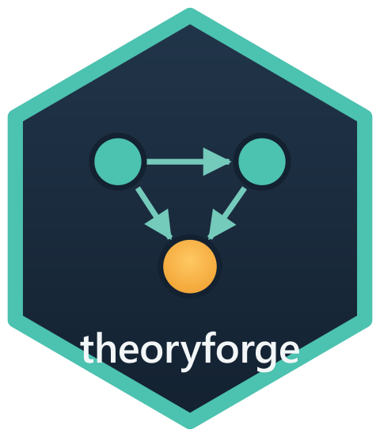

# theoryforge <small>(R)</small> <a href="https://pablobernabeu.github.io/theoryforge/r/"></a>

<!-- badges: start -->
[](https://CRAN.R-project.org/package=theoryforge)
[](https://github.com/pablobernabeu/theoryforge/actions/workflows/ci.yml)
[](https://lifecycle.r-lib.org/articles/stages.html#experimental)
[](https://opensource.org/license/MIT)
[](https://doi.org/10.32614/CRAN.package.theoryforge)
<!-- badges: end -->

Systematic theory development: a reproducible workflow for building, developing and testing
scientific theories. This is the feature-parity twin of
[the Python package](https://pablobernabeu.github.io/theoryforge/python/) of the same name. The
two implementations produce identical verdicts and byte-identical diagram intermediate
representations. See `?theoryforge` for the shared specification behind that guarantee.

## Interactive web app

Run the package in your browser, with no installation, using the
[interactive web app](https://pablobernabeu.github.io/theoryforge/apps/r/). It executes the
package client-side via [webR](https://docs.r-wasm.org/webr/latest/). You can load a theory
and run the operations the app offers, from the rigour checklist through to the literature map,
and then get the R code that reproduces each result. Each figure can be exported as SVG or PNG.

## Installation

theoryforge is on [CRAN](https://CRAN.R-project.org/package=theoryforge):

```r
install.packages("theoryforge")
```

The development version installs from GitHub, pointing at the package's subdirectory in the
[monorepo](https://github.com/pablobernabeu/theoryforge) it shares with its Python twin:

```r
# install.packages("remotes")
remotes::install_github("pablobernabeu/theoryforge", subdir = "r/theoryforge")
```

From a local checkout, the package also installs as source:

```r
# from the repository root
install.packages("r/theoryforge", repos = NULL, type = "source")
```

The package depends on `yaml` and `jsonlite`.

## Quick start

```r
library(theoryforge)

# Read a bundled example theory (or build one incrementally with tf_theory + tf_add_*)
theory <- tf_read(system.file("fixtures", "panic-network.theory.yaml",
                              package = "theoryforge"))
tf_validate(theory)

# Score it against the 12-item rigour checklist
report <- tf_check(theory)
report$aggregate_score   # 87.3
report$gate              # "pass"
```

[Get started](https://pablobernabeu.github.io/theoryforge/r/articles/theoryforge.html) walks
through building, checking and diagramming a theory.
[Developing and testing](https://pablobernabeu.github.io/theoryforge/r/articles/developing-and-testing.html)
continues into severity, implied conditional independencies, preregistration, amendment
appraisal and the audit dossier, and
[Mapping the literature](https://pablobernabeu.github.io/theoryforge/r/articles/literature.html)
shows how to position a theory within a bibliometric corpus.

## Public API

The [reference index](https://pablobernabeu.github.io/theoryforge/r/reference/) lists every
exported function, grouped by workflow stage. `tf_render_diagram()` renders any
digraph view in the viewer through DiagrammeR, or as a standalone SVG string
with `as = "svg"`. The rendering packages are listed in Suggests, so the deterministic core
has no dependency on them. For the rationale behind each rigour check and
exactly how every reported value is computed, see
[Methodological foundations](https://pablobernabeu.github.io/theoryforge/r/articles/methodology.html).

## Citation

```r
citation("theoryforge")
```

The DOI that CRAN assigned to the package is
<https://doi.org/10.32614/CRAN.package.theoryforge>, and it covers every version.

The [About page](https://pablobernabeu.github.io/theoryforge/r/articles/about.html) carries the
same citation with a BibTeX entry, and a short note on the developer. The repository also
includes `CITATION.cff`, which GitHub uses for its 'Cite this repository' button.

## Licence

MIT. See the [full licence text](https://pablobernabeu.github.io/theoryforge/r/LICENSE.html).

## Contributing

Issues and pull requests are welcome. The [contributing
guide](https://github.com/pablobernabeu/theoryforge/blob/main/.github/CONTRIBUTING.md)
describes the development setup and the conventions the package follows, and everyone taking
part is asked to honour the [Code of
Conduct](https://github.com/pablobernabeu/theoryforge/blob/main/.github/CODE_OF_CONDUCT.md).

Continuous integration runs `R CMD check --as-cran` in six configurations, covering the
released R on macOS, Windows and Ubuntu, R-devel on Windows and Ubuntu, and oldrel-1 on Ubuntu.
A further job runs the suite on the declared R 4.1 minimum. The Python suite and the
cross-language parity check run alongside these R jobs.
